# Screens

What the extension looks like in Keycloak's default theme: setting it up in the admin console,
what users see when a sign-in is checked, challenged or blocked, and the events it records.
Select an image for the full size.

Generated by `npm run docs-screens:docker` in `e2e/` (see [CONTRIBUTING.md](../CONTRIBUTING.md#docs-screenshots)):
don't edit by hand.

- [Setup](#setup)
- [Sign-in](#sign-in)
- [Events](#events)

## Setup

<table>
<tr><td valign="top" width="400"><a href="images/setup/authentication-flows.png">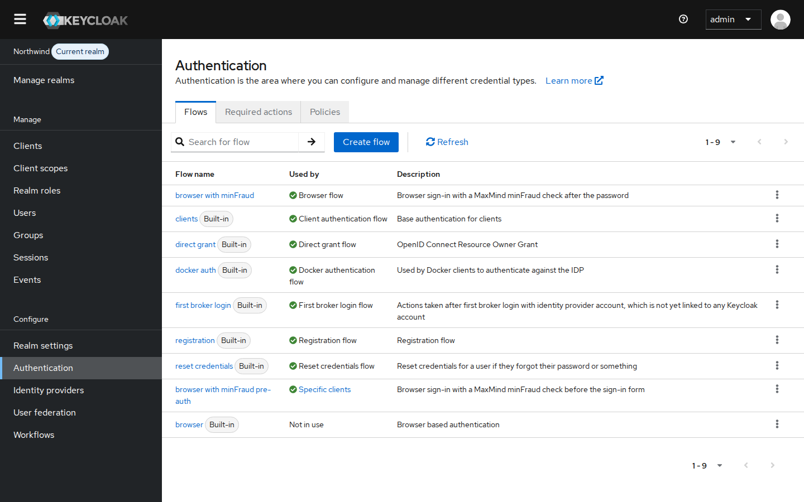</a> <b>Authentication flows</b> A copy of the browser flow with minFraud is the realm's browser flow; a pre-authentication copy is bound to one client.</td><td valign="top" width="400"> <b>The browser flow with minFraud</b> Post-authentication: minFraud checks the sign-in after the password, and the MFA enforcer acts on a challenge.</td></tr>
<tr><td valign="top" width="400"><a href="images/setup/add-step.png">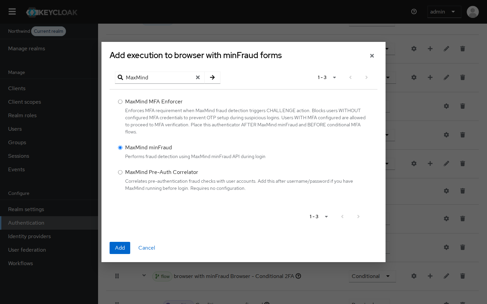</a> <b>Adding the minFraud step</b> The extension adds three steps: MaxMind minFraud, the MFA enforcer and the pre-authentication correlator.</td><td valign="top" width="400"><a href="images/setup/minfraud-config.png">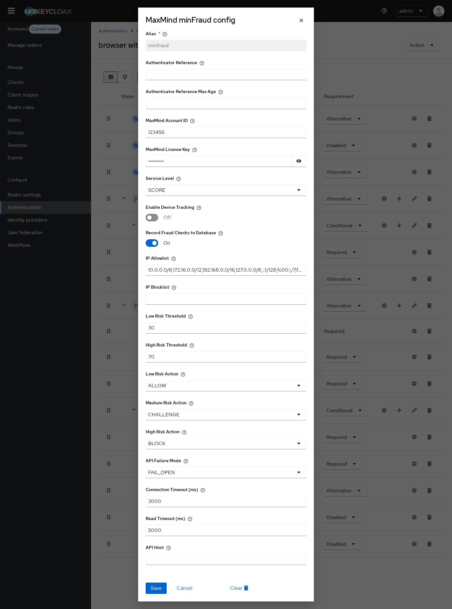</a> <b>minFraud settings</b> Account, service level, device tracking, IP lists, risk thresholds and actions, failure mode and timeouts.</td></tr>
<tr><td valign="top" width="400"><a href="images/setup/mfa-enforcer-config.png">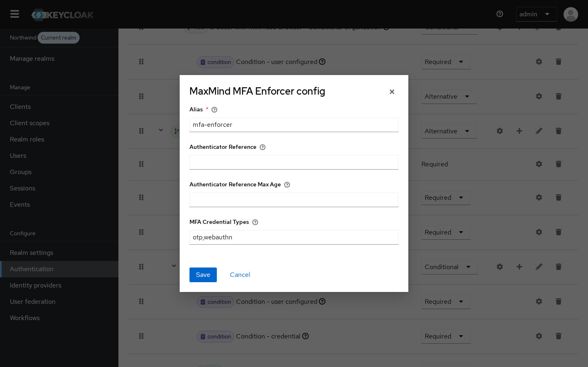</a> <b>MFA enforcer settings</b> Which credentials count as a second factor when minFraud asks for one.</td><td valign="top" width="400"><a href="images/setup/pre-auth-flow.png">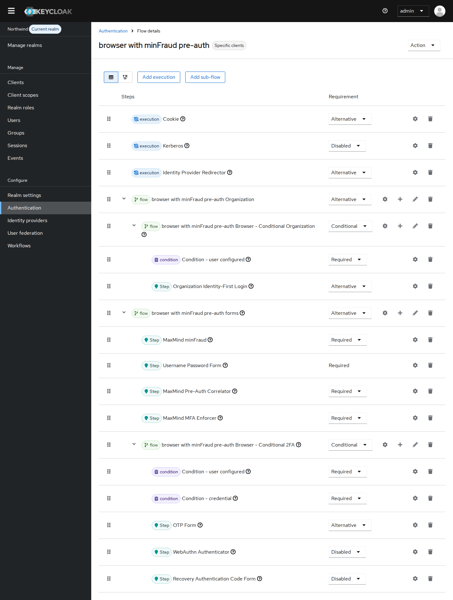</a> <b>The pre-authentication flow</b> Pre-authentication: minFraud checks the address before the sign-in form, and the correlator links the check to the user.</td></tr>
</table>

## Sign-in

<table>
<tr><td valign="top" width="400"><a href="images/sign-in/device-tracking.png">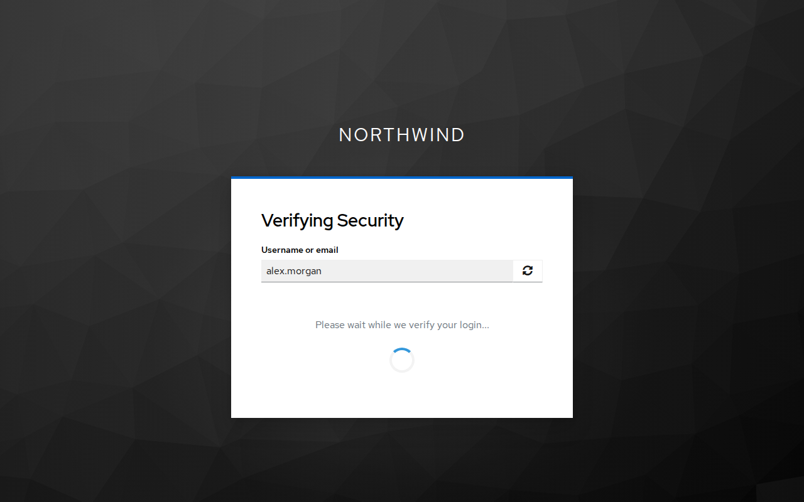</a> <b>Device tracking</b> With device tracking on, MaxMind's device script runs for a moment after the password.</td><td valign="top" width="400"><a href="images/sign-in/step-up-otp.png">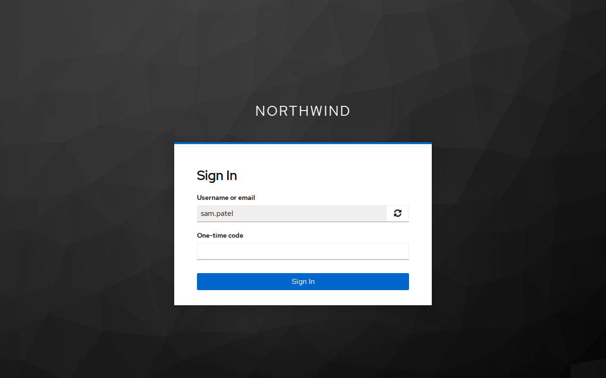</a> <b>Medium risk: second factor</b> A medium score with CHALLENGE: users with a second factor are asked for it.</td></tr>
<tr><td valign="top" width="400"><a href="images/sign-in/mfa-required.png">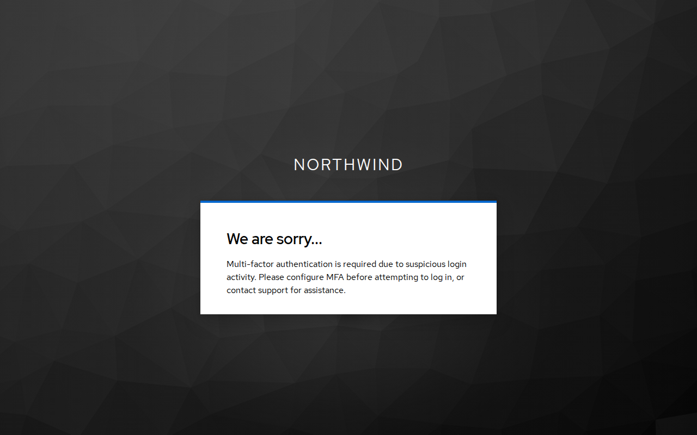</a> <b>Medium risk: no second factor</b> The MFA enforcer stops users without one, so they can't set one up during a suspicious sign-in.</td><td valign="top" width="400"> <b>High risk: blocked</b> A high score with BLOCK denies the sign-in.</td></tr>
<tr><td valign="top" width="400"> <b>Blocklisted address</b> Addresses on the IP blocklist are denied without asking minFraud.</td><td valign="top" width="400"><a href="images/sign-in/fail-closed.png">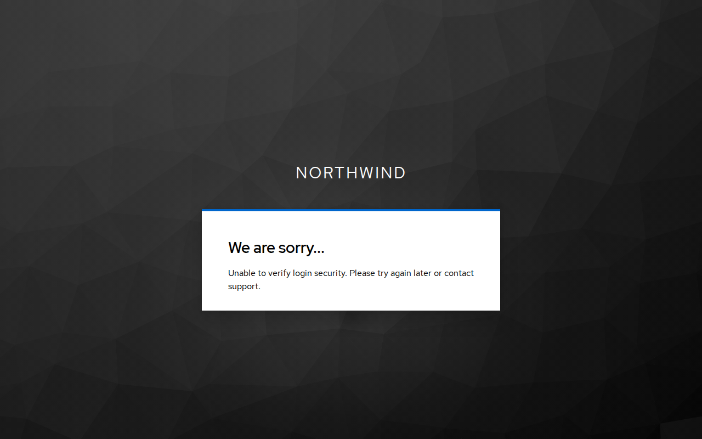</a> <b>minFraud unavailable (FAIL_CLOSED)</b> When minFraud can't be reached, FAIL_CLOSED denies the sign-in (FAIL_OPEN lets it through).</td></tr>
</table>

## Events

<table>
<tr><td valign="top" width="400"><a href="images/events/login-allowed.png">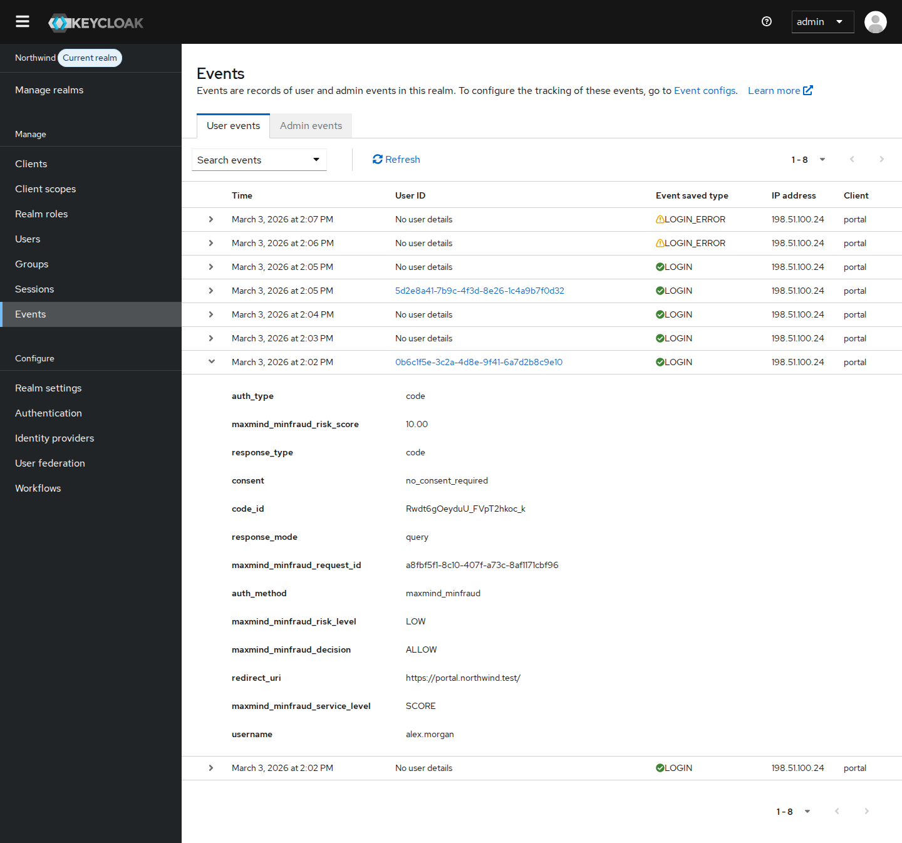</a> <b>An allowed sign-in</b> A LOGIN event with minFraud's risk score, risk level and decision, its request id and the service level.</td><td valign="top" width="400"><a href="images/events/login-challenged.png">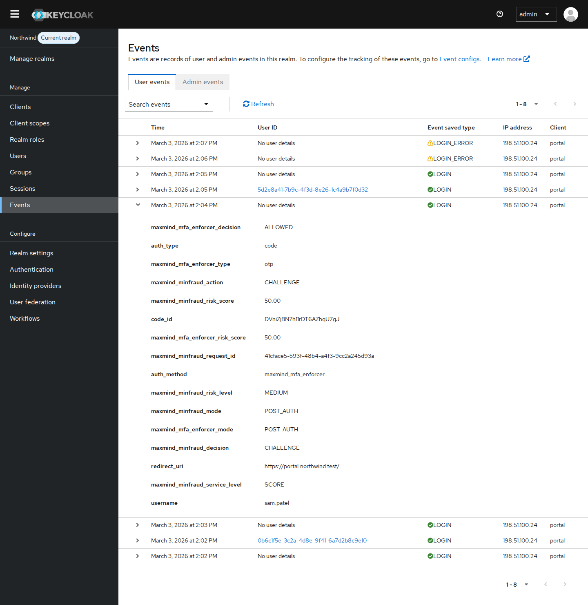</a> <b>A challenged sign-in</b> A medium-risk sign-in (CHALLENGE) that the MFA enforcer let through to the user's second factor.</td></tr>
<tr><td valign="top" width="400"><a href="images/events/login-blocked.png">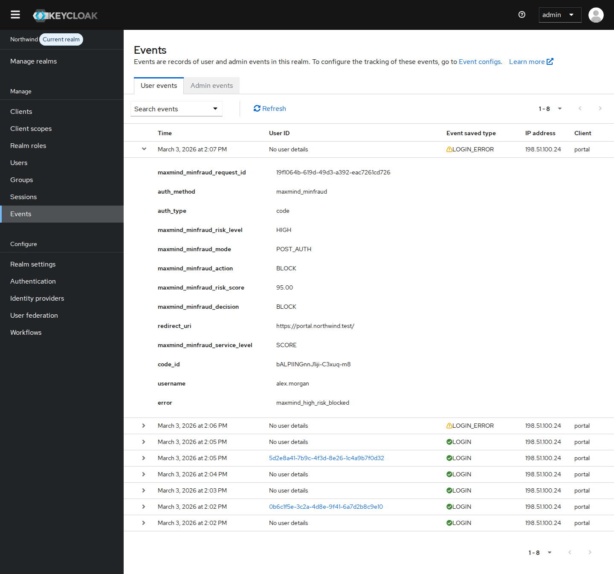</a> <b>A blocked sign-in</b> A LOGIN_ERROR event for a high-risk sign-in that minFraud's score blocked.</td></tr>
</table>
